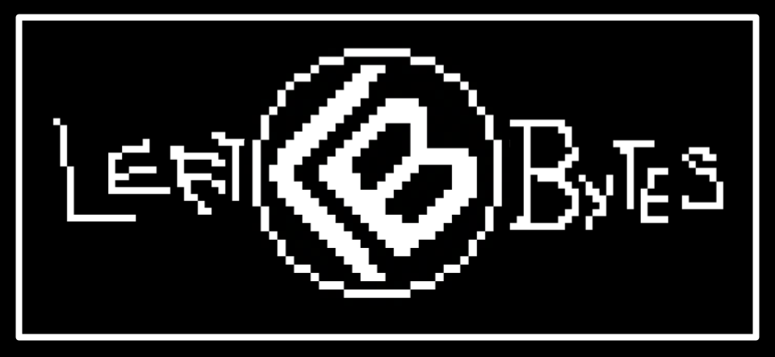

<h1 align="center">LeetBytes</h1>

<p align="center">Lil app to shove my LeetCode solutions.</p>

<p align="center">The long-term idea is to turn this into a pixel-styled coding playground where solutions are not just listed, but explored through visuals, code running, and small games that unlock hints.</p>

---

## Features

**Practice**

- 38 problems, mostly LeetCode plus a few company-sourced ones, each graded against a hidden test suite.
- In-browser Python editor with **Run** (your own editable example cases) and **Judge** (the hidden suite), showing per-case results plus runtime and memory.
- Handles linked lists, trees, and "design" problems (a class plus method calls, like LRU Cache and Min Stack).

**Learn**

- A write-up of my solution on every problem: intuition, algorithm steps, and complexity analysis, with the code itself kept behind a reveal overlay so it can't be spoiled by accident.
- Three hints per problem, each locked until you win a minigame round.
- Topic and company tags, with LeetCode's frequency score on tracked companies.

**Play**

- The hint minigame roulette: a Mario Kart item box flickers between games, lands on one, and starts a 60-second round. Win to unlock the next hint; lose and retry re-spins.
  - **Tetris**: hold slot, 6-piece next queue, ghost piece, 7-bag randomizer.
  - **Snake**: eat the target number of apples before time runs out.
  - Targets get harder with each hint level.

**Track**

- Questions list with search and tri-state filters (level, status, topic, company), where each chip cycles off → is → is not.
- Progress page with practice history, a solved/difficulty summary, and a GitHub-style contribution calendar.
- A stopwatch and countdown timer in the problem page's navbar.

Everything is wrapped in a pixel-art UI: animated landing page, bordered-panel modals, and a game-style loading bar between pages.

## Getting Started

You'll need Node 20+, [pnpm](https://pnpm.io), and Python 3 (for the local code runner).

```bash
pnpm install   # once, installs the whole workspace
pnpm dev       # client on :3000, server on :4000
```

Run and Judge need a code runner. The public Piston API went whitelist-only on
February 15, 2026, so for local development use the local Python runner instead:

```bash
pnpm dev:local   # same as pnpm dev, with CODE_RUNNER=local-python
```

The local runner executes code straight through your own Python install, so it's only
for trusted code on your own machine. For anything public-facing, self-host
[Piston](https://github.com/engineer-man/piston) and point `PISTON_API_URL` at it.
All runner options live in [byte_backend/README.md](byte_backend/README.md).

`pnpm typecheck` checks every package at once.

## Architecture

```txt
leetbytes/               pnpm workspace
    byte_frontend/       Next.js app: pages, editor, test panel, solution view, minigames
    byte_backend/        Node HTTP API: judges code and serves public test cases
    byte_shared/         @leetbytes/shared: request/response types and Zod schemas used by both sides
    byte_problems/       @leetbytes/problems: one folder per problem, the single source of truth
```

```txt
                  browser
                     │
        Next.js app  │  /api/* rewrite (one origin in dev, no CORS)
                     ▼
                 Node API ───► Python harness ───► code runner
                     │                            (local Python or Piston)
                     ▼
              @leetbytes/problems
```

### Public vs. Hidden

Each problem lives in `byte_problems/<slug>/` as two files. `public.ts` holds everything
the browser may see: the description, examples, starter code, hints, and my solution
with its write-up. `hidden.ts` holds the judged test suite and answer key, and only the
server ever imports it. A `ProblemSlug` union in `byte_problems/types.ts` keys both
registries, so the two sides can't drift apart, and a `public.ts` file must never
import from a `hidden.ts` file.

### How a Judge Run Works

1. The browser sends the code and the problem's slug to the server.
2. The server looks up that problem's hidden suite and wraps the code in a Python
   harness. The harness turns the JSON test inputs into real Python objects (linked
   lists, trees), calls the solution (or drives the class, for design problems), and
   turns the return value back into JSON.
3. A pluggable runner executes the harness, either through a local Python install or
   a Piston server.
4. Each result is compared against the expected answer using the problem's compare
   mode (exact, order-independent, or order-independent for lists of lists), and
   runtime and memory are measured along the way.
5. The server returns a verdict (accepted, wrong answer, runtime error, time limit
   exceeded, and so on) with a per-case breakdown.

### Client-Side State

Hint progress, minigame results, and the Progress page's submission history all live in
the browser (`localStorage`). There are no accounts and nothing is stored on the server,
so progress doesn't follow you across browsers or devices.

### Company Tags

Company tags and their frequency numbers come from a generated file
(`byte_problems/company-tags.generated.ts`), built by a manual sync script that reads a
public community-maintained dataset. It doesn't scrape LeetCode. To refresh it:

```bash
pnpm --filter @leetbytes/problems run sync:companies
```

Then review the diff and commit. Nothing runs on a schedule.

## Adding a Problem

1. Add the slug to `PROBLEM_SLUGS` in `byte_problems/types.ts`.
2. Create `byte_problems/<slug>/public.ts` with the description, examples, hints,
   starter code, my solution, and its write-up.
3. Create `byte_problems/<slug>/hidden.ts` with the judged tests.
4. Register both in `byte_problems/public.ts` and `byte_problems/hidden.ts`. The
   typechecker complains until every slug has a public entry.

Problems from other sources (like company assessments) work too. See
[byte_problems/README.md](byte_problems/README.md) for the details.

## Docs

Each package has its own README with the details:

| Package | What's inside |
| --- | --- |
| [byte_frontend](byte_frontend/README.md) | Components, pages, and how the minigame roulette works |
| [byte_backend](byte_backend/README.md) | API routes, the judge, and runner options |
| [byte_problems](byte_problems/README.md) | Problem layout, design problems, and company tags |
| [byte_shared](byte_shared/README.md) | The shared request/response types and schemas |

---

Please don't hurt me LeetCode.
